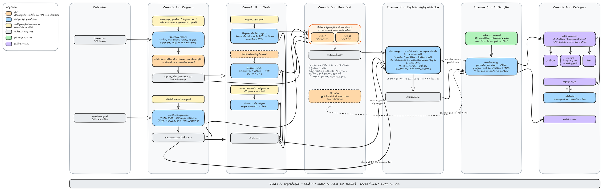

# Case: classificação de questões em temas (Penal, Processo Penal, Legislação Especial, Criminologia)

Pipeline que decide, para cada uma das 359 questões, `publicar`, `revisar` ou `fora`,
com precisão prevista ≥ 95% nas publicadas. Este README é atualizado a cada etapa.

## Arquitetura

[](docs/arquitetura.excalidraw)

Diagrama editável: [`docs/arquitetura.excalidraw`](docs/arquitetura.excalidraw) (abra em [excalidraw.com](https://excalidraw.com) → menu → Abrir).

## Como rodar

```bash
make setup                 # cria .venv (Python 3.12) e instala requirements.txt
cp .env.example .env       # e coloque sua OPENAI_API_KEY
make teste-modelos         # 1 chamada por modelo: confere acesso (< US$ 0,001)
```

## Estado das etapas

| Etapa | Comando | Status |
|---|---|---|
| 0. Setup | `make setup` | feito |
| Amostra do gabarito (às cegas) | `make gold-amostra` | feito: 80 questões em `data/gold/` |
| 1b. Árvore: tratamento | `python -m src.temas_tratamento` | feito → `data/interim/temas_tratados.csv` |
| 1b. Árvore: descrições (LLM) | `python -m src.temas_descricoes` | feito (US$ 0,99) → `temas_descricoes.jsonl` |
| 1b. Árvore: tabela final | `python -m src.temas_textos` | feito → `data/interim/temas_classificacao.csv` |
| 1a. Questões | `make questoes` | feito → `data/interim/questoes_tratadas.csv` |
| 2. Sinais | `make sinais` | feito (US$ 0,003) → `data/interim/sinais.csv` |
| 3. Juiz LLM | `make juiz` | feito (US$ 3,12) → `data/interim/votos_llm.csv` |
| 4. Decisão | `make decisao` | feito → `data/interim/decisoes.csv` (níveis; limiar sai da etapa 5) |
| 5. Calibração | `make avaliacao` | feito → `data/interim/calibracao.json` (critério pontual; 15/80 rotuladas) |
| 6. Entregas | `make entregas` | feito → `outputs/publicacao.csv` (114 publicar · 243 revisar · 2 fora), `previsao.txt`, `metricas.md` |

Explicação de cada módulo: [temas](docs/modulo_temas.md), [questões](docs/modulo_questoes.md), [sinais](docs/modulo_sinais.md), [juiz](docs/modulo_juiz.md), [decisão](docs/modulo_decisao.md), [calibração](docs/modulo_avaliacao.md), [entregas](docs/modulo_entregas.md).
Revisões e perguntas em aberto: [`PENDENCIAS.md`](PENDENCIAS.md).

## Modelos

Definidos em `config/settings.yaml`: `gpt-5.4-mini` (A), `gpt-6-luna` (B), `text-embedding-3-small`.
Custo e tempo reais de cada etapa ficam em `outputs/custos.json`; `make custos` mostra o custo de reprodução por etapa e o gasto real (cache inteiro).

## Configurações: o que é do software e o que é desta base

O código não depende desta base de dados. Parte dos arquivos em `config/`, porém, é **curadoria manual
da árvore `temas.csv` deste case**, com `tema_id` específicos. A escolha pela curadoria manual foi
deliberada: cada decisão é revisável e tem o motivo registrado em `DECISOES.md`, em vez de uma heurística
automática que pode errar em silêncio.

| Arquivo | Natureza | Para usar com outra base |
|---|---|---|
| `settings.yaml` | software (modelos, preços, caminhos, suposições) | continua valendo |
| `genericos.yaml` → `padroes` | regra geral (regex de títulos introdutórios) | continua valendo (árvore em português jurídico) |
| `genericos.yaml` → `lixeiras_conhecidas`, `excecoes` | curadoria desta base | refazer à mão |
| `duplicatas.yaml` | proposta automática + revisão | apagar, rodar `python -m src.temas_tratamento --propor-duplicatas` e revisar |
| `correcoes_grafia.yaml` | curadoria desta base | refazer à mão |
| `disciplinas_origem.yaml` | curadoria desta base (disciplina de origem → disciplina da árvore) | refazer à mão; disciplina desconhecida faz o preparo falhar |
| `regras_leis.yaml` | curadoria (lei → tema) | refazer à mão; tema inexistente faz a etapa falhar |
| `mapa_assunto_origem.csv` | proposta automática + revisão | apagar, rodar `python -m src.sinais --propor-mapa-assunto` e revisar |
| `sobreposicoes.yaml` | curadoria desta base (a listagem de títulos parecidos impressa pelo tratamento ajuda) | refazer à mão |

Proteção: se um arquivo curado citar um `tema_id` inexistente ou não publicável, ou se uma correção não
achar o trecho exato no título, o tratamento **falha com mensagem clara**. Config velha numa base nova
não é aplicada em silêncio.

## Estrutura

```
data/raw/      anexos originais (somente leitura)
data/interim/  artefatos intermediários
data/gold/     gabarito manual
config/        settings.yaml e mapas revisados à mão
src/           um módulo por etapa; cliente_api.py concentra cache e custo
prompts/       prompts versionados (.md)
outputs/       entregas, métricas e custos
tests/         testes da função de acerto e do validador
docs/          explicação de cada módulo
cache/         respostas da API (fora do versionamento)
```
